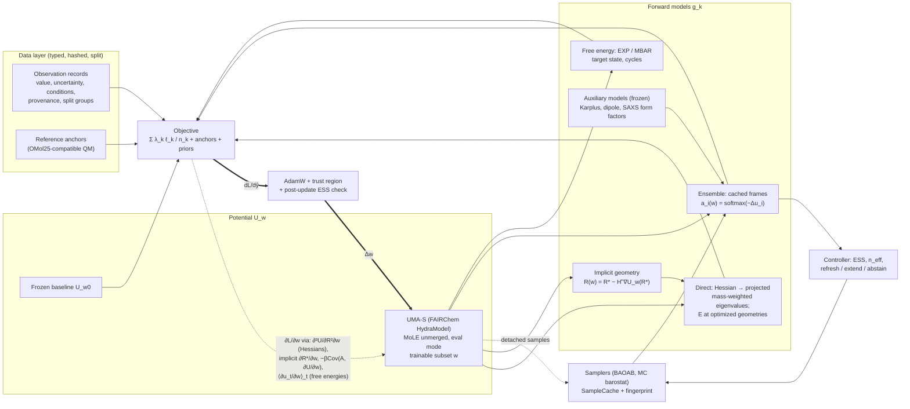
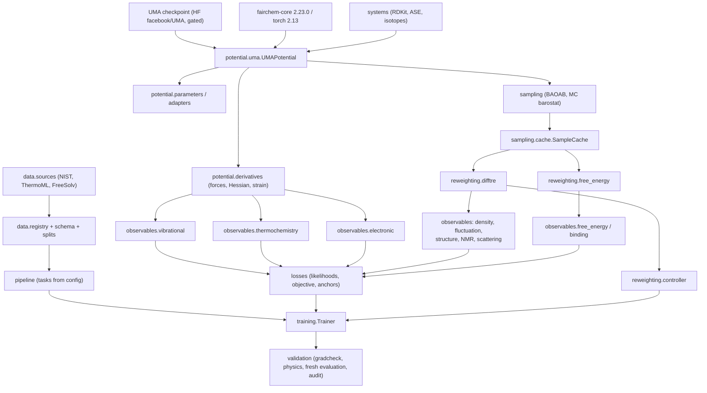

# Fine-tuning UMA's weights through experimental observables: design and implementation

*Reference date: 26 September 2026. This document answers the ten deliverables of
`uma_experimental_finetuning_prompt.md` §15 and records what was built and what was
verified in this repository. Where a statement comes from a measurement made here,
the command that reproduces it is given. Where it is a planning value, it is labeled
as one.*

---

## 0. Status at a glance

> **Update 2026-10-07 (supersedes the rows below where they conflict).**
> - **Real weights.** `uma-s-1p1` has been in use since 2026-10-06. The Stage-0
>   audit passes on the real weights: parity ≤ 1.6e-7 eV under the same
>   settings; force, Hessian, parameter-gradient and third-order checks pass
>   (`runs/audit_uma_s_1p1/audit.json`). Cell strain was not checked with the
>   omol task.
> - **Vibrational experiment.** An adversarial review found several problems,
>   and the work now follows a pre-registered protocol with a decision log
>   (`experiments/vib_v1/PROTOCOL.md`, `DECISIONS.md`). Corrections:
>   1. **Old splits retired.** The pilot's old vibrational test split (benzene
>      alone, 5 usable modes) was scored and seen. All 15 pilot molecules are
>      development data.
>   2. **Assignment was wrong in verified cases.** `degeneracy_sorted` matches
>      by sorted order, which in 1-D is the optimal matching and hides ordering
>      errors. It also fell back to value-based matching:
>      - C2H4 au4 was assigned to a g-parity wag;
>      - C2H6's near-degenerate a1g/a2u stretches were merged and two modes
>        silently dropped;
>      - benzene ν14 and ν7 were also misassigned.
>
>      Replaced by symmetry-constrained assignment (`observables/symmetry.py`).
>      Axis conventions are resolved from the species counts. It is value-free
>      except within any class that is still merged; there, matching ranks
>      measured values (no dev molecule needs one). Review later found and
>      fixed a D2d defect and cross-species averaging.
>   3. **The scaled forward model leaks anharmonicity into the weights.**
>      `fundamental_scaled` lets the readout absorb anharmonicity and the global
>      scale (H2O and D2O need different scales). Vib-v1 instead adds base-model
>      GVPT2 corrections (`observables/vpt2.py`).
>      - Validation covers exact spectra of model Hamiltonians
>        (`tests/test_vpt2.py`) and real-weight invariance inside degenerate
>        subspaces.
>      - That validation did not catch the cross-species averaging bug; review
>        did.
>   4. **Parser v1 bugs.** It missed Fermi-resonance and overtone codes in the
>      Comments column, flagged every mode of centrosymmetric molecules as
>      inactive, and dropped the double primes of Cs species. v2 fixed those.
>      v3 and v3.1 then made it fail closed: CH3OH ν12 was usable despite an
>      "undefined" comment and a range value.
>   5. **Worked example D used a non-stationary geometry.** It sits at the ASE
>      water geometry (forces up to 0.48 eV/Å); UMA's harmonic frequencies at
>      its own minimum are 1621.8/3821.0/3920.5 cm⁻¹.
>   6. **Withdrawn interpretation.** Narrative claims that the largest baseline
>      residuals were "physically plausible" are withdrawn (D-06).
> - **Still open.** The `pipeline.density_tasks` starting density uses measured
>   values (D-15, open).

| Area | State | Evidence |
|---|---|---|
| UMA as a trainable potential | **Built and verified on the UMA-S architecture with random weights.** Uses the native FAIRChem model: MoLE unmerged, eval mode (no dropout), selected parameters trainable. | `tests/test_uma_potential.py`, `scripts/audit_uma.py` |
| Load parity vs FAIRChem predictor | 6.9e-9 eV / 4.1e-9 eV Å⁻¹ with the same settings. 3.1e-7 eV vs FAIRChem's default merged+compiled fp32 path. | `docs/results/audit_random_architecture.json` |
| Real UMA weights (`uma-s-1p1`) | Available since 2026-10-06; see the update above. | `runs/audit_uma_s_1p1/audit.json` |
| Derivative orders | Forces, Hessian, cell strain, dL/dw, and ∂/∂w of Hessian-derived losses match finite differences to between 6.5e-10 and 1.6e-7 relative. | §9.1 |
| Observable families | All 14 are in the registry with explicit status (`observables/base.py::REGISTRY`): 6 implemented from U_w alone (vibrational, density, EOS, fluctuations, thermochemistry, structure); 5 implemented with an auxiliary model or external reference leg (SAXS, NMR, IR, solvation endpoints, electronic, where IE/EA is done and pKa/redox are not); 2 evaluation-only (dynamical VDOS, kinetics); 1 interface-only (binding). | §4 |
| Equilibrium estimators | DiffTRe reweighting (full-graph and memory-bounded surrogate modes), controller, trust region. Differentiable EXP, BAR, MBAR, TI and target-state free energies. | `tests/test_reweighting.py`, `tests/test_free_energy.py` |
| Pilot data | 110 NIST fundamentals, 431 FreeSolv ΔG_hyd and 49 ThermoML densities. Typed, hashed and license-audited. The splits were made per family and are **not** consistent across families (red-team report #2, M4); superseded by the Vib-v1 reserved set. | `data/manifests/pilot_manifest.json` |
| Stage-2 pipeline | Runs end to end on real NIST targets with the UMA-S architecture. With random weights, invalid predictions (unconverged geometries, imaginary modes) correctly abstain. | `scripts/train.py`, §9.3 |
| Stage-3 pipeline | Tested on a liquid with known ground truth. Reweighting, refresh, abstention, overlap-limited steps and fresh-simulation gates all work. **Levenberg–Marquardt with the overlap line search recovers the true (ε, σ) to < 0.1% in 7 steps from a joint density + energy fit.** Adam did not converge in 45 steps, and a density-only fit is non-identifiable (lands 14% off in ε). | `scripts/run_equilibrium_pilot.py`, §9.3.1 |
| Tests | 162 tests as of 2026-10-07; coverage not re-measured since 2026-09-26. The old assignment test was circular (expected values built from the computed ones); symmetry assignment and VPT2 now have known-answer tests. | `pytest` |

---

## 1. Assessment of the proposal

**The mechanism is sound once "energy" is replaced by "energy landscape".** One scalar
energy at one geometry cannot determine measured quantities. Each observable needs its
own forward map. That map may use energy differences, coordinate derivatives,
optimized structures, ensembles, trajectories, or an auxiliary property model. Gradients
must reach UMA's weights through the same objects. Every branch implemented here does
this, and each gradient path was checked by finite differences in this repository.

### What is feasible now

1. **Direct observables** are feasible now: harmonic vibrational frequencies (via
   fundamentals with an explicit anharmonic/NQE forward model), reaction thermochemistry,
   and gas-phase adiabatic ionization energies and electron affinities. The UMA-S
   architecture on FAIRChem's `general` backend supports double backward through every
   operation on the energy path. The only custom `autograd.Function`s in the model code
   sit in paths not used for training:
   - the Triton fast path, which is GPU-only;
   - the Euler-angle Wigner path, which is off by default because quaternion Wigner
     matrices are used instead;
   - graph-parallel communication.

   We measured d/dw of a Hessian-based loss against finite differences at 4.4e-9
   relative error. Cost scales as 3N backward passes per Hessian.
2. **Equilibrium ensemble observables** (density, fluctuations, RDFs, populations, NMR/SAXS
   through frozen forward models) use cached samples and DiffTRe-style reweighting.
   Long MD trajectories never enter the autograd graph. The gradient identity
   (autograd = −β Cov(A, ∂U/∂w)) holds to machine precision here.
3. **Free energies** (solvation, and binding as the advanced branch) are implemented as
   UMA endpoint corrections on top of reference-potential decoupling cycles. Their
   training gradient comes from an unsampled MBAR target state and is exact. Running
   the MM decoupling legs needs an external engine; this is the main integration gap.
4. **Kinetics and excited states** are outside what reweighting a ground-state potential
   can deliver. They are evaluation-only, or need dedicated estimators or models (§4).

### Main scientific uncertainties

- **Which potential is being fit?** UMA's `omol` task is a surrogate for
  ωB97M-V/def2-TZVPD electronic energies on aperiodic structures. Fitting classical-MD
  ensemble averages to experiment without NQE corrections produces an *effective
  potential for classical simulation at that protocol*, and must be labeled as such. The
  default here keeps the target an electronic potential and moves anharmonicity, NQE
  and missing physics into explicit, uncertain forward models (§6.2, §6.5).
- **Periodic liquids with `omol`.** The UMA documentation states that OMol25 training
  data are aperiodic and that "periodic systems should be treated with some caution".
  Published evaluations disagree:
  - Kumar et al. (arXiv 2603.20183) report good agreement with experimental
    electrolyte densities and X-ray structure factors.
  - The GRACE-OFF paper (JCTC 2026, DOI 10.1021/acs.jctc.6c01169; ChemRxiv
    10.26434/chemrxiv.15001529) reports that its two-layer models beat
    UMA/OMol25-S for water and hexane. A search-result excerpt of that paper
    attributes to UMA-S an overestimate of hexane density by more than 10%; we could
    not open the full text to verify this (403 from ACS and ChemRxiv).

  The density branch therefore requires an explicit opt-in on the `System`, and held-out
  liquids must pass before any claim is made.
- **Identifiability.** A few hundred observations cannot pin down 1.5 × 10⁸ weights.
  The defaults restrict the trainable set (readout, routing, or adapters), anchor to the
  frozen baseline and compatible quantum data, and check whether improvements survive
  fresh sampling and independent observables (§9). The LJ pilot shows the failure mode
  concretely: a density-only fit lands on a ridge of (ε, σ) pairs.
- **Shared readout.** In UMA-S 1.1 the energy head is shared by all tasks
  (`DatasetSpecificSingleHeadWrapper`). Updating it moves `omat`, `omc` and the other tasks
  as well. A fine-tuned checkpoint must be declared single-task (`omol`) unless the other
  tasks are replayed.
- **Composition-dependent experts.** MoLE coefficients depend on composition, charge,
  spin and task. Updates to routing or experts act differently on different compositions,
  so generalization must be tested on held-out compositions, not only on held-out
  conformers.

### Main engineering uncertainties

Gated checkpoint access, FAIRChem API churn, sampling cost, and Hessian memory.

- **Churn:** 2.23.0 already rejects UMA 1.0 checkpoints and back-fills `model_id` for
  1.1, so versions are pinned.
- **Sampling cost:** measured on an M1 Pro, energy+forces for 192 atoms takes 1.24 s on
  MPS fp32, so NPT liquid sampling at useful lengths needs a CUDA GPU.
- **Hessian memory:** about 3N × (energy+forces cost) with `create_graph`.

---

## 2. Architecture: forward computation and gradient paths



The solid arrows carry values. The dotted arrow summarizes the four gradient routes into
UMA's weights:

1. **Mixed derivatives** ∂³U/∂R²∂w, through Hessians of U_w.
2. **The implicit function theorem** for optimized geometries: dR*/dw = −H⁺ ∂(∇U)/∂w,
   attached with a detached Newton step whose value is R* and whose derivative is exact.
3. **Distributional derivatives of ensemble averages**: d⟨A⟩/dw = ⟨∂A/∂w⟩ − β Cov(A, ∂U/∂w).
   Autograd reproduces this through the normalized weights; the surrogate mode applies it
   chunk by chunk.
4. **Free-energy derivatives**: d f_t/dw = ⟨∂u_t/∂w⟩_t for an unsampled MBAR target state.

Samples are always detached. The potential that generated them is identified by a
parameter fingerprint, so a stale cache cannot be used silently.

---

## 3. Bill of materials

### 3.1 Dependency graph



### 3.2 Components

Legend for **Status**:
- **R**: ready-made and used as-is.
- **C**: custom code in this repository.
- **I**: interface only; needs an external engine or data.

| Component | Role / interface | Implementation (file) | Status |
|---|---|---|---|
| Trainable potential | `energy(system, R (B,N,3), h (B,3,3)) → eV (B,)` float64, differentiable in R, h, w | `potential/uma.py::UMAPotential` wraps FAIRChem `HydraModel` loaded with `load_inference_model(use_ema=True)`; MoLE unmerged; `regress_config.forces=False` (we differentiate the energy ourselves) | C over R |
| Frozen baseline | Same inputs → reference energies/forces | `UMAPotential.frozen_copy()` (deep copy, `requires_grad=False`) | C |
| Energy convention | Head output → total energy | `EnergyConvention`: E = rmsd·E_head + mean + Σ ref[Z]; read from the checkpoint's `tasks_config` | C (verified vs FAIRChem) |
| Parameter selection | Choose which UMA weights change | `potential/parameters.py` presets (readout 33,153 · routing 35,488 · last_block 36.6 M · experts 144.7 M · full 146.6 M) | C |
| Symmetry-preserving adapters | W = W₀ + AB on existing UMA tensors | `potential/adapters.py` (torch `parametrize`); zero-init parity; merge for export | C |
| Additive correction | U = U_w0 + ΔU_ψ comparator (**does not update UMA**) | `potential/correction.py` (element-pair Gaussian radial basis, cosine cutoff) | C |
| System builder | Identity + conditions → atoms, masses, charge/spin, task, PBC, molecules | `systems/` (RDKit ETKDGv3, isotope table from AME2020, liquid packing) | C over R |
| Experiment registry | Raw → typed observations with provenance and splits | `data/schema.py` (Pydantic v2), `data/registry.py` (Parquet), manifest with SHA-256 | C |
| Reference-data registry | QM anchors with the same theory as the task | `losses/anchors.py::AnchorSet` (energy *differences* + forces) | C (data not downloaded) |
| Derivative engine | Forces, Hessians, cell/strain derivatives, parameter gradients | `potential/derivatives.py` (autograd; `rows` or `vmap` Hessian) | C |
| Sampler | Potential + state → frames | `sampling/integrators.py` (BAOAB, MC barostat with COM scaling, NVE), `sampling/md.py` | C |
| Sample cache | Frames + reference energies + identity | `sampling/cache.py` (npz + json; system hash, state, protocol, sampling fingerprint) | C |
| Observable modules | Potential (+ cache) → prediction + variance | `observables/*.py` (§4) | C |
| Reweighting / free energy | Cached samples + current energies → expectations, ΔF, overlap diagnostics | `reweighting/difftre.py`, `reweighting/free_energy.py` | C (validated vs pymbar) |
| Objective | Predictions + targets → scalar loss | `losses/likelihood.py`, `losses/objective.py` | C |
| Optimizer | Controlled update | AdamW (torch) + trust region + post-update ESS rejection in `training/trainer.py` | C over R |
| Sampling controller | Diagnostics → accept / extend / refresh / reject / abstain | `reweighting/controller.py`, `training/cache_manager.py` | C |
| Validation and tracking | Checkpoints → reproducible assessment | `validation/{gradcheck,physics,evaluation,audit}.py`; JSONL logs; training checkpoints with RNG state | C |

### 3.3 Per-component contracts

| Component | Inputs → outputs (shapes, units) | Differentiable in | Cost drivers | Failure modes and guards |
|---|---|---|---|---|
| `UMAPotential.energy` | R (N,3) or (B,N,3) Å; h (3,3) Å; system (Z, q, S, task, pbc) → E () or (B,) eV float64 on CPU | R, h, w (and R(w)) | edges ≈ N·neighbors within 6 Å; MoLE einsum over 32 experts; fp64 about 1.7–2× fp32 | Merged MoLE or `no_grad` would cut w-gradients: never used. Direct-force checkpoints are rejected. The periodic `omol` task requires opt-in. On MPS, the fp64 reduction is swapped for a same-dtype reduction (verified 1e-7 rel). |
| `hessian` | R (N,3) → H (3N,3N) eV Å⁻² | R, w (create_graph) | 3N backward passes, each about 1–2× an energy+forces call | Symmetrized. Checked against FD (1.6e-7 rel). |
| `modes_from_hessian` | H, R, masses → ν̃ (3N−6|5) cm⁻¹ signed, modes (detached) | H, R | eigh (3N)³ | Degenerate sets handled by eigenvalue-only gradients; imaginary modes reported, never clamped. |
| `attach_implicit_geometry` | R* (detached), U_w → R(w) | w | one Hessian at R* (detached) | Needs a converged minimum. Flags `max_force` and imaginary modes. |
| `ReweightedEnsemble.estimate` | cache (F frames), frame fn A → ⟨A⟩, SEM, ESS, g | w (weights + explicit A_w) | F energy evaluations (chunked) | ESS, max weight, β σ(Δu) and n_eff = min(ESS, F/g) go to the controller. |
| `target_state_free_energy` | u_kn (sampled, detached), u_t(w) → f_t | w | K·N reduced potentials | Overlap diagnostics. BAR/MBAR sensitivities are labeled as non-training gradients. |
| `run_sampling` | potential, system, ThermoState, protocol → SampleCache | no | steps × force-call cost | Non-finite energy aborts. Barostat adaptation only during equilibration. |
| `combine_objective` | [(Prediction, Target)] → total + breakdown | predictions, nuisances | negligible | Invalid predictions are skipped and recorded. Family normalization is explicit. |
| `Trainer.step` | tasks → logged update | all trainable params + nuisances | sum of the above | Non-finite or all-zero gradients skip the update. A post-update ESS collapse reverts parameters **and** optimizer state. |

---

## 4. Observable-family registry

`observables/base.py::REGISTRY` is the machine-readable version of this table.
"Shares H" means the observable is determined by U_w plus masses and the thermodynamic
state, with no extra property model.

| Family | Forward calculation (implemented) | Main sources | Sampling | Gradient route | Uncertainty treatment | Shares H | Status |
|---|---|---|---|---|---|---|---|
| Vibrational frequencies | ν̃ᵢ = sign(λᵢ)√\|λᵢ\|/(2πc), λ from P D P (D = M^{-1/2} H M^{-1/2}); mode assignment by degeneracy class, tracked by eigenvector overlap; fundamentals via scaled or VPT2-corrected harmonic model | NIST WebBook / Shimanouchi (D1); isotopologues | none (optimized geometry) | implicit (R*(w)) + mixed third derivatives | rating range → sd; relative model-discrepancy sd (stop-gradient); scale-factor prior | yes | **Implemented** |
| VDOS | harmonic: from Hessian eigenvalues; dynamical: VACF spectrum | MD only | NVE/weak thermostat | path | n/a | yes | Harmonic implemented; dynamical evaluation-only |
| Density, EOS | ρ = M/⟨V⟩_NPT; ⟨P⟩_NVT via virial (strain derivative) | ThermoML (D2) | NPT (MC barostat) | reweighting (+ explicit for virial) | sampling sd (delta method, n_eff) + measurement | yes | **Implemented** |
| Compressibility, expansion, Cp | κ_T = ⟨δV²⟩/(kT⟨V⟩); α_P = ⟨δVδH⟩/(kT²⟨V⟩); C_P = C_kin + ⟨δH²⟩/(kT²) + harmonic quantum correction | ThermoML (D2) | long NPT | reweighting with explicit U_w | as above; correction uncertainty in model variance | yes | **Implemented** (classical + optional QC) |
| Thermochemistry | balanced-reaction ΔE, ΔH(T), ΔG(T) with RRHO/qRRHO; ΔvapH from two ensembles | NIST (D1), ATcT (not integrated), ThermoML | none / NVT gas + NPT liquid | envelope theorem + implicit frequencies; reweighting | per-species; reference cancellation checked | yes | **Implemented** |
| Structure / populations | RDF (per-frame volume normalization), ⟨rⁿ⟩^{1/n}, dihedral-state indicators | literature; not a label source: PDB (D8) | NVT/NPT | reweighting | frame covariance/n_eff | yes | **Implemented** |
| SAXS/SANS, diffraction | Debye sum with Cromer–Mann f(q); S(q) from partial RDFs (Lorch window); scale/offset profiled | SASBDB (D7) | NVT/NPT | reweighting | correlated q-errors via covariance; nuisance profiling | needs solvent/contrast model | **Implemented with auxiliary model** |
| NMR | ³J via Karplus (Vuister & Bax 1993, model sd 0.73 Hz); NOE ⟨r⁻⁶⟩^{-1/6} or ⟨r⁻³⟩²; shifts via frozen predictor | BMRB (D6) | NVT | reweighting (frozen model transmits through weights) | model sd added | no | **Implemented with auxiliary model** |
| Hydration / solvation / partition | ΔG(UMA) = ΔG(ref) + ΔG_ref→UMA(soln) − ΔG_ref→UMA(gas); ML/MM or full-UMA endpoints | FreeSolv (D3), SAMPL (D4) | reference-potential decoupling (external) + endpoint samples | target-state MBAR/EXP | reference-cycle sd + overlap | yes (endpoints) | Estimators implemented; **MM legs need an external engine** |
| Binding | ΔG° = RT ln(K_d/c°); cycle bookkeeping; Boresch analytic restraint; assay guards (IC50/EC50 rejected without an assay model) | BindingDB (D5), SAMPL host–guest (D4) | as solvation, plus complex | target-state MBAR | censoring, assay model | yes (endpoints) | **Interface** (advanced) |
| IR/Raman intensities, dielectric | I_k ∝ \|∂μ/∂Q_k\|² (double harmonic); perturbative eigenvector re-attachment for non-degenerate modes | NIST quantitative IR (D1) | none / NVT for ε | implicit | dipole-model error | **no** (dipole model required) | **Implemented with auxiliary model** |
| Diffusion, viscosity, rates | Einstein MSD + Yeh–Hummer; VACF spectra; unrolled NVE gradient (research) | ThermoML transport, primary literature | NVE / validated dynamics | path (research only) | time-correlation convergence | yes | **Evaluation-only** (reweighting is not a kinetic estimator) |
| pKa, redox, excited states | gas-phase adiabatic IE/EA from charge/spin-resolved `omol` energies (+ΔZPE) | NIST ion energetics (D1) | none | envelope + implicit ZPE | vertical vs adiabatic labeling | yes for IE/EA | IE/EA **implemented**; solution pKa/redox need a solvation cycle; excited states **out of scope** |

**Shared framework.** Every family returns a `Prediction(value, variance, valid, reason,
diagnostics, backward_fn)`, and every experimental record becomes a `Target`. One
objective and one trainer handle them all. Families that are determined by U_w plus state
(vibrations, thermochemistry, density, fluctuations, structure, free-energy endpoints,
IE/EA) can share **one** physical Hamiltonian in joint training. NMR, SAXS and IR need an
auxiliary model. Those models are frozen by default, so experimental information reaches
UMA only through the ensemble or the normal modes. Test `test_vibrational_loss_reaches_uma_weights`
and the Karplus/NOE reweighting path show this pattern.

---

## 5. Dataset manifest and curation plan

### 5.1 Pilot manifest (built 2026-09-26)

`python scripts/build_pilot_dataset.py` produced
`data/manifests/pilot_manifest.json` and `pilot_splits.json`:

| Registry | Records | Value kind | Source and license | Redistribution | Split (train/val/test) |
|---|---|---|---|---|---|
| `vibrational.parquet` | 110 fundamentals, 15 molecules (H2O, D2O, NH3, CH4, H2CO, HCN, C2H2, C2H4, C2H6, CH3OH, H2S, CH3Cl, HCOOH, C6H6, CH3CN) | evaluated | NIST WebBook SRD 69 (Shimanouchi 1972 compilation) | **restricted**: kept local, regenerated by script | 73 / 17 / 20 |
| `solvation.parquet` | 431 hydration free energies (H, C, N, O only; 642 in FreeSolv) | evaluated | FreeSolv, CC BY 4.0 | allowed with attribution | 302 / 65 / 64 |
| `density.parquet` | 49 pure-liquid densities, 7 compounds, 288–318 K, ≈1 bar, 12 articles | measured | NIST TRC ThermoML Archive (journal data) | unknown: kept local | 29 / 12 / 8 |

The builder recorded several findings rather than hiding them:

- **Missing tables.** SO₂, CH₂F₂ and CO₂ have no Shimanouchi table on the WebBook.
- **NH₃.** Its inversion-doubled rows were merged and flagged; its phase column is blank
  (flag `phase_not_stated`).
- **CH₄.** ν₁ and ν₂ are flagged inactive, and ν₂ is also flagged Coriolis-observed.
- **FreeSolv uncertainties.** 395 of the 431 records carry a *default-assigned*
  uncertainty (flag `default_uncertainty_assigned`).
- **Compilation DOIs.** One FreeSolv compilation DOI and one ThermoML DOI each exceeded
  20% of their records. They were excluded from split linking and reported (§5.3).

### 5.2 Deterministic extraction and curation rules

| Source | Access | Rules (recorded in each record's `transformation_history`) |
|---|---|---|
| D1 NIST WebBook | `cbook.cgi?ID=<id>&Mask=800`, 1 request/s; raw HTML stored with SHA-256 | "Selected Freq." → EVALUATED. The rating letter's range is parsed from the page's own Notes table, with sd = upper bound/2. Inversion-doubled rows are merged. Footnotes → flags (inactive, Coriolis, Fermi, calculated, condensed phase, phase not stated). Temperature is left missing. `primary_reference_not_resolved` is set. |
| D2 ThermoML | `trc.nist.gov/ThermoML/<DOI>.xml` (archive through 2019) | Namespace-agnostic parse of every data point. Pure single-component "Mass density, kg/m3", liquid phase. Expanded uncertainty with its confidence level, sd = U/2 at 95%. T from variables; p from variables or constraints (kPa → bar). Sample purity is kept in the raw XML. |
| D3 FreeSolv | `database.json` | Only `expt`, `d_expt` and `expt_reference` are used; `calc*` fields are never used. Default-uncertainty flag. Ben-Naim standard state. InChIKey block = molecule group; Murcko scaffold; DOI = publication group. |
| D4–D11 | see `data/sources/catalog.py` | Candidate roles, license status, and what each source must *not* be used for. For example, a PDB conformation is not a Boltzmann label, and SPICE uses a different level of theory than `omol`. |

**Gaps** (`catalog.GAPS`):

- **Transport** needs targeted extraction from ThermoML viscosity data and primary
  diffusion papers.
- **Adiabatic IE/EA** needs a parser for NIST ion energetics that distinguishes vertical
  from adiabatic values.
- **Absolute IR intensities** are available from NIST quantitative gas-phase spectra for
  a handful of molecules.
- **Protein conformational populations** have no general dataset; none is fabricated.

### 5.3 Leakage controls

`data/splits.py` places observations that share any key (molecule, scaffold, publication,
system cluster) in the same split. It uses union-find over observations, assigns
components deterministically from a hash of the seed, and verifies the result with
`assert_no_leakage`.

- **Isotopologues** share the *non-isotopic parent* InChIKey block. H₂O and D₂O probe
  the same surface and must not straddle splits; standard InChIKeys would separate them.
- **Compilation keys** covering more than 20% of records identify a compilation rather
  than one study's correlated errors. They are excluded from linking and reserved for a
  separate leave-provenance-out evaluation.
- **Protein systems** would add sequence-identity clusters in `system_group`.

---

## 6. Equations and worked examples

### 6.1 Mathematical contract (as implemented)

$$U_w(Z,R,Q,S,h,b,d),\qquad F_w=-\nabla_R U_w,$$

- **w**: the selected UMA weights (plus adapter factors, if used).
- **Z, Q, S, b, d**: `System.atomic_numbers`, `charge`, `spin` (`omol`: multiplicity;
  other tasks: 0), `pbc`, and `task`. These enter FAIRChem's `AtomicData` as `charge`,
  `spin` and `dataset`, as verified in the source code.
- **R and h**: tensors. Temperature and pressure never enter U_w. They enter only
  through the ensemble (reduced potential u = β(U + pV)), so no state-dependent
  effective potential is created.

For family k,

$$\hat y_k = g_k[U_w,\mathcal S,c_k;\phi_k],\qquad \mathcal L=\sum_k\lambda_k\,\ell_k(\hat y_k,y_k)/n_k+\lambda_Q\mathcal L_Q+\lambda_B\mathcal L_B+\lambda_P\mathcal L_P+\sum_j\pi_j(\phi_j),$$

$$\frac{d\mathcal L_k}{dw}=\frac{\partial\mathcal L_k}{\partial\hat y_k}\frac{d\hat y_k}{dw}.$$

The trainer computes ∂L/∂ŷ with autograd. Graph-mode predictions then continue into w
directly, while surrogate predictions run their `backward_fn(∂L/∂ŷ)`.

### 6.2 Vibrations

$$H_w=\nabla_R^2U_w(R^*),\quad D_w=M^{-1/2}H_wM^{-1/2},\quad P=I-X(X^\top X)^{-1}X^\top,$$
$$D' = PD_wP + c\,(I-P),\qquad \tilde\nu_i=\frac{\operatorname{sign}(\lambda_i)\sqrt{|\lambda_i|}}{2\pi c_{\rm light}}\times\sqrt{\frac{e}{\text{Å}^2\,\mathrm u}}.$$

Here X spans the mass-weighted rigid translations and rotations (two rotations for
linear molecules). The conversion constant is **521.4709 cm⁻¹** per √(eV Å⁻² u⁻¹),
tested in `tests/test_units.py`.

**Why the shift c(I − P).** Projecting with P alone leaves a (3N−6)-fold degenerate
eigenvalue, and eigenvector derivatives through a degenerate spectrum are undefined.
Only eigenvalue derivatives are used; `torch.linalg.eigh` then back-propagates
V diag(g) Vᵀ, which needs no eigen-gaps.

**Degeneracy, assignment and imaginary modes.**
- Degenerate sets (E/T/Π) are averaged, so the gradient is basis-invariant.
- Assignment is discrete and never differentiated. Computed modes are grouped by
  degeneracy and matched in frequency order within each degeneracy class. After the
  baseline assignment is reviewed, it is frozen and tracked by subspace overlap
  (Hungarian algorithm).
- Imaginary modes are reported and invalidate the prediction; they are never clamped.

**Geometry response.** R(w) = R* − H⁺∇U_w(R*) with H⁺ detached (the internal-space
pseudo-inverse). Its value is R*, and its derivative is the implicit-function-theorem
result. The fixed-geometry variant is available and labeled as such.

**Comparison with experiment** is one of three forward models:
- harmonic targets (ω_e);
- scaled fundamentals ν = sω, where s is a nuisance with a Gaussian prior (planning
  value 0.955 ± 0.02; calibrate on the validation split);
- ν = ω + Δ_anh, with Δ_anh taken from a reference VPT2 calculation together with its
  uncertainty.

In every case a relative model-discrepancy variance is added. That variance is computed
under a **stop-gradient**, which prevents the fit from lowering its loss by shifting ω to
inflate its own error bars; worked example D shows why this matters.

**NQE and anharmonicity** are not absorbed into U_w silently. Their size is carried in
the model variance or in explicit corrections.

### 6.3 Ensemble averages and reweighting

$$u(x)=\beta[U(R)+\text{bias}]+\beta pV,\qquad \log a_i(w)=-[u_t(x_i;w)-u_s(x_i)]-\operatorname{logsumexp}_j(\cdot),\qquad \hat A(w)=\sum_i a_i(w)A_w(x_i).$$

The sampling reference u_s uses the energies of the potential that actually drove the
dynamics. For example, an MPS float32 copy is corrected exactly by importance weights.

For NPT at an unchanged (T, p), the pV and V^N measure terms cancel. A changed T or p
enters through (β_t − β_s)U and (β_t p_t − β_s p_s)V, which is tested against the
ideal-gas ⟨V⟩ = (N+1)/(βp). The canonical identity

$$\nabla_w\langle A\rangle=\langle\nabla_wA\rangle-\beta\,\mathrm{Cov}(A,\nabla_wU_w)$$

is reproduced by autograd to 1e-16 relative (worked example C).

**Surrogate mode (memory-bounded).** Given g = ∂L/∂⟨A⟩,

$$S(w)=\sum_i c_iU_w(x_i)+\sum_{i,k} d_{ik}A_{wk}(x_i),\quad c_i=-\beta a_i\sum_kg_k(A_{ik}-\langle A_k\rangle),\ d_{ik}=a_ig_k,$$

has ∇S = dL/dw exactly and is back-propagated one chunk at a time.

**Diagnostics.**
- Kish ESS = 1/Σaᵢ².
- β·sd(Δu).
- Maximum weight.
- Statistical inefficiency g (Chodera 2007; matches `pymbar` to 1e-6).
- n_eff = min(ESS, F/g), which feeds the delta-method variance of the reported
  prediction.

Nominal ESS cannot detect an unsampled basin. That risk is handled by fresh-simulation
gates (§9), not by the controller.

### 6.4 Free energies

- **EXP:** Δf = −ln⟨e^{−Δu}⟩₀.
- **BAR:** solved by Brent's method, then implicitly differentiated.
- **MBAR:** self-consistent iteration followed by Newton polishing, then implicitly
  differentiated with f(w) = f* − J⁻¹R(f*, u(w)), where J = ∂R/∂f is detached and the
  gauge is fixed at f₀ = 0. Values match `pymbar` to 1e-7, and derivatives match
  re-solved finite differences to 1e-5.

**Which gradient is valid for training.** Differentiating BAR or MBAR with the samples
fixed gives the *estimator's sensitivity*, not dΔF/dw. Once w changes, samples drawn from
the old state no longer come from the new one. The training route treats the updated
potential as an **unsampled MBAR target state**:

$$f_t(w)=-\ln\sum_n\frac{e^{-u_t(x_n;w)}}{\sum_kN_ke^{f_k-u_k(x_n)}},\qquad \frac{df_t}{dw}=\Big\langle\frac{\partial u_t}{\partial w}\Big\rangle_t .$$

This was checked against the analytic value to 3% on 10⁴ samples. The tests caught this
distinction: my first BAR test wrongly expected the fixed-sample derivative to equal
0.5/k.

The standard-state relations used are:

- Binding: ΔG° = RT ln(K_d/c°), with c° = 1 M = 6.022 × 10⁻⁴ Å⁻³.
- Boresch release (Boresch et al. 2003, Eq. 32):
  −kT ln[8π²V°√(ΠK)/(r₀² sinθ_A sinθ_B (2πkT)³)].
- Conversion between concentration conventions: kT ln(c_gas/c_soln).

### 6.5 Thermochemistry

- **Reactions.** ΔX = Σ_s ν_s X_s for X ∈ {E_el, E + ZPE, H(T), G(T)}.
  `check_balance` requires every element and the total charge to balance, and a single
  UMA task, so that element references and per-atom offsets cancel exactly.
  Formation enthalpies relative to elemental standard states are **refused**: graphite
  would need a periodic task with a different reference theory than `omol`.
- **RRHO.**
  - Translation: Sackur–Tetrode.
  - Rotation: from the moments of inertia and symmetry number σ.
  - Vibration: harmonic, with optional quasi-RRHO below 100 cm⁻¹ (Grimme 2012).
  - Electronic: k ln(2S+1).
  - Validated against NIST standard entropies: S°(H₂O, g, 298.15 K) computed as
    188.84 ± 0.3 J mol⁻¹ K⁻¹ from experimental fundamentals and geometry;
    S°(Ar) = 154.85.
- **Vaporization enthalpy.** ΔvapH = ⟨U⟩_gas − ⟨U⟩_liq/N + RT, from two reweighted
  ensembles. The ideal vapour is explicit, and the p V_liq term is neglected; the size of
  that neglect is stated in the code.

### 6.6 The three gradient routes compared

| Route | Used for | Memory | Variance | Bias / validity |
|---|---|---|---|---|
| Direct derivatives (autograd through U_w and its R-derivatives) | forces, Hessians, virials at given configurations | full graph: about 3N row graphs for a create_graph Hessian (benzene 6.0 GB; decane was killed for out-of-memory on 16 GB). **HVP mode**: one double-backward graph at a time (benzene 2.2 GB, decane 3.4 GB), about 2–3× slower | none (deterministic) | exact |
| Implicit differentiation through equilibria / minimizations | optimized geometries (R*), MBAR/BAR free energies, self-consistent estimators | one extra detached Hessian or Jacobian solve | none, beyond the estimator's own | exact at a converged solution. Biased when the geometry is unconverged (hence the `fmax` gate) or when the estimator equation is solved loosely |
| Reweighting (DiffTRe) of cached equilibrium frames | ensemble averages, fluctuations, structure, free-energy targets | F energy evaluations. Chunked surrogate: O(chunk) memory | grows as ESS falls, roughly Var/(n_eff); controlled by refresh/reject | exact for equilibrium, time-independent observables under the sampled ensemble. **Not valid for kinetics.** Blind to unvisited basins |
| Differentiable dynamics (unrolled) / path reweighting | time-correlation functions, transport (research only) | grows with window length (unrolled) | high (chaotic divergence); path reweighting variance grows with time | unrolled: exact for the window but truncated. Girsanov reweighting: valid for Langevin dynamics (not implemented) |

Long-trajectory backpropagation is never the default for equilibrium properties, and
reweighting equilibrium frames never stands in for a kinetic gradient.

### 6.7 Worked small-system examples (numbers from `python scripts/worked_example.py`, saved in `docs/results/worked_example.json`)

**A. Morse diatomic (analytic).** Parameters D = 4.6 eV, a = 2.2 Å⁻¹, r_e = 0.97 Å, with
¹⁶O¹H masses. The frequency is ν̃ = √(2Da²/μ)/(2πc).

| | code (autograd, implicit geometry) | exact |
|---|---|---|
| ν̃ | 3573.737013120027 cm⁻¹ | 3573.737013120026 |
| ∂ν̃/∂D | 388.44967533917 | ν̃/(2D) = 388.44967533913 |
| ∂ν̃/∂a | 1624.4259150547 | ν̃/a = 1624.4259150546 |
| ∂ν̃/∂r_e | 0 | 0 |

**B. Why the implicit geometry term matters.** The system is a bent triatomic with
harmonic bonds and angle, differentiated with respect to the equilibrium angle θ₀:

| d(Σν̃)/dθ₀ | value (cm⁻¹ rad⁻¹) |
|---|---|
| implicit geometry (this code) | 44.392970 |
| finite differences with full re-optimization | 44.392970 (agreement 1e-8) |
| fixed geometry (a common shortcut) | 5.407 (8× wrong) |

**C. DiffTRe identity.** A 3D harmonic well is sampled exactly at k = 1.5 eV Å⁻² (4 atoms,
300 K, 4000 samples). The results are d⟨r²⟩/d ln k = −0.2068579277967649 from autograd,
−0.2068579277967650 from the explicit −βCov, and −0.206816 exactly (0.02% sampling error).

**D. Water on the UMA-S architecture (random weights), from Hessian to UMA's readout.**

1. H is 9×9 by double backward.
2. P D P gives 3 vibrational modes.
3. ω is scaled by s = 0.955 and compared with the NIST fundamentals 1595, 3657 and
   3756 cm⁻¹ (sd 0.5 cm⁻¹ plus 1.5% model discrepancy).
4. The Gaussian NLL is formed.
5. ∂NLL/∂w reaches all readout tensors except the final per-atom bias, which cannot
   affect a Hessian.

A directional finite-difference check of the whole chain passes at **8.9e-9 relative**.
With random weights the "frequencies" (150, 502, 508 cm⁻¹) are meaningless; the example
demonstrates only the chain of derivatives.

The first version of this check failed at 90% relative error. The reason: finite
differences saw the model-discrepancy variance change while autograd (correctly, by
design) did not. That episode is why §6.2 documents the stop-gradient.

---

## 7. Parameter strategy, sampling, optimizer and software stack

### 7.1 Trainable-parameter strategy

These presets were measured on the UMA-S architecture (fairchem 2.23.0; 146,566,817
parameters in 149 tensors, 5 of which are frozen dataset embeddings):

| Preset | Tensors | Parameters | Changes | Use |
|---|---|---|---|---|
| `readout` | 6 | 33,153 | per-atom energy MLP (shared across tasks) | **default first stage**; lowest drift risk |
| `readout_norm` | 8 | 33,665 | + final equivariant RMS norm scales | small extension |
| `routing` | 7 | 35,488 | MoLE routing MLP + composition embedding | changes the expert mixture per composition, charge and spin; every result is still an exact UMA-architecture model |
| `radial` | 50 | 1,132,672 | edge radial MLPs | distance dependence of messages |
| `last_block` | 36 | 36,599,425 | final message-passing block (incl. its experts) | broader; needs replay/anchors |
| `experts` | 24 | 144,703,488 | all MoLE expert weights | broadest; strongest anchoring |
| adapters | e.g. 3 tensors, rank 2–8 | ≈10⁴–10⁵ | W₀ + AB inside UMA's own SO(2)/linear operators | parameter-efficient broad changes |
| additive ΔU (comparator) | – | ~10² | pair correction, UMA frozen | ablation only; **does not meet the central requirement** |

**Hessian memory.** Vibrational losses default to the full create_graph Hessian.
Above roughly 15–20 atoms on a 16 GB machine, set `vibrational.memory_mode=hvp`. That mode
diagonalizes a detached Hessian and back-propagates G = ∂L/∂H = Σₖ g_λₖ uₖuₖᵀ as Σₖ g_λₖ
uₖᵀH(w)uₖ, one Hessian-vector product at a time. The gradient is identical (tested to
1e-8) at bounded memory (§9.5).

**Recommendation.** Start with `readout`, then compare it against `routing` and against
rank-4 adapters on `blocks.3.*.fc_m0`, with `λ_B` baseline replay throughout. Move to
`last_block` only if validation improves without physical regressions (§9). The shared
readout moves every task's surface, so **the fine-tuned checkpoint is declared
`omol`-only**.

**Adapter safety.**
- The delta is added to an existing weight tensor and used by UMA's own operator. SO(2)
  equivariance comes from how weights act on m-components, not from the weight values,
  so it is inherited.
- After randomizing adapter factors, energies are rotation-invariant to 1e-8 eV and
  forces rotate correctly (`test_adapters_preserve_parity_symmetry_and_merge`).
- Zero-initialized B gives exact parity, and `merge_adapters` bakes the delta into
  plain weights for export (`UMAPotential.export_inference_checkpoint`). The export
  round-trip through FAIRChem's loader is tested.

### 7.2 Sampling strategy

| Setting | Choice |
|---|---|
| Equilibrium properties | Sample with U_w0 (cached, fingerprinted) and reweight to U_w. Refresh below ESS fraction 0.5. Reject an update when post-update ESS falls below 0.1–0.15, and extend when n_eff or sampling sd is insufficient. If sampling is still insufficient after the allowed actions, **abstain**. The first pilot run accepted noisy estimates and diverged, which led to this rule. All thresholds are starting values to tune on validation systems. |
| Samplers | BAOAB Langevin (NVT) plus an MC barostat moving molecular centres of mass in ln V, with acceptance exp(−β[ΔU + pΔV] + (N_mol+1) ln V′/V). The barostat step adapts only during equilibration. NVE velocity Verlet is used for drift checks. |
| Devices | CPU fp64 for Hessians and reweighting energies. Apple MPS fp32 for large-system sampling: 1.6× faster than CPU fp32 at 60–190 atoms, forces 1e-7 relative to CPU fp64. MPS needs a scoped swap of FAIRChem's float64 node→system reduction, and tensors must move to the CPU before being cast to float64. Verified: frames sampled on MPS and re-evaluated in CPU fp64 differ by at most 2.3e-7 eV, giving an ESS fraction of 1.0000 (`test_mps_sampling_reweights_exactly_to_cpu_fp64`). |
| Enhanced sampling | PLUMED (optional) stores bias energies in `SampleCache.bias`. They enter u_s and are removed exactly by reweighting. |
| External engines | Sampling can run in any engine (for example OpenMM with a UMA plugin) as long as frames and the sampling potential's energies are stored. Gradients never pass through the engine; they come from re-evaluating U_w in PyTorch on the cached frames. |

### 7.3 Optimizer

AdamW with explicit safeguards:

- **Gradient checks** before stepping: every gradient must be finite, and at least one
  trainable tensor must have a non-zero gradient.
- **Clipping and trust region.** Gradients are clipped. The trust region caps
  ‖Δw‖ ≤ ρ·max(‖w‖, floor). The floor was added after a pilot showed that a purely
  relative cap freezes parameters that sit near zero.
- **Post-update rejection.** If ESS collapses after a step, parameters and optimizer
  state are reverted and the learning rate shrinks.
- **Learning rate.** An optional per-step decay is available.
- **Regularizing toward the pretrained weights.** Plain AdamW weight decay pulls
  fine-tuned weights toward *zero*, which is the wrong anchor. The trainer offers L2-SP,
  ½λ‖w − w₀‖² in parameter space, and baseline drift on replay configurations in function
  space. Nuisance parameters, biases and norm scales sit in no-decay parameter groups.

**Second optimizer: Levenberg–Marquardt in observation space** (`optimizer: lm`).
Experimental fits have *few* observables and *many* parameters. The Gauss–Newton step
can be solved in the n_obs × n_obs dual:

$$\Delta w = -J^\top\,(JJ^\top+\lambda I)^{-1}\,r,$$

- **r**: residuals whitened by the full covariance and scaled by family weights, with
  nuisance priors added as extra rows.
- **J**: one row per observed component. It is obtained by back-propagating a unit
  vector through the prediction (autograd, surrogate or HVP callbacks), plus direct
  dependence on nuisances.

Cost is n_obs backward passes per step, and memory is O(n_obs × n_params). That is
trivial for 33k readout weights and feasible for the full model when n_obs is small.

**Step length.** Damping is scale-free: λ = 10⁻³ · tr(JJᵀ)/n_obs. The step *length* is
set by an **overlap-limited line search**: the step is halved along the Gauss–Newton
direction until the post-update reweighting ESS clears the rejection threshold.

The first version instead raised λ 10× on each ESS collapse, which is ForceBalance-like
damping. It failed: steps shrank to about 10⁻³ in log-parameter space and the fit
stalled (§9.3.1). The diagnostic showed why. The reweighted Jacobian at the start of the
LJ problem gives a Gauss–Newton step of Δlog ε = 0.169, against the true offset of
0.1625, so the *direction* is right. Reweighting, not the linearization, limits how far
one step can go.

**Measured behaviour.**
- On the toy triatomic it recovers the true force constants to 1e-4 in 8 steps. Adam
  needed 300 steps to reach 1e-3.
- On the known-truth LJ liquid, see §9.3.

It does not include L2-SP, baseline or quantum terms. Bound it with λ and the trust
region, or alternate it with Adam steps that carry those terms.

L-BFGS is appropriate only for smooth, deterministic objectives, such as direct
observables at fixed assignments. It is not appropriate with noisy ensemble gradients.
Gradient-balancing or multi-objective methods should be introduced only after inspecting
real per-family gradient conflicts. RL is unnecessary.

### 7.4 Minimal software stack (verified versions in `requirements.lock`)

| Library | Version | Role | Integration boundary |
|---|---|---|---|
| fairchem-core | 2.23.0 | UMA model, checkpoint loading | Stock `MLIPPredictUnit` freezes weights and merges MoLE, so it is used only as the parity reference. |
| torch | 2.13.0 | autograd, Hessians, optimizers | Double backward checked through all ops on the `general` backend; Triton fast paths are GPU-only and have no double backward. |
| ase | 3.29.0 | structures, I/O | FAIRChem's ASE calculator returns NumPy, so it never appears in a training path. |
| rdkit | 2026.03.6 | identity, isotopes, ETKDG | preparation only |
| numpy / scipy | 2.4.6 / 1.18.1 | L-BFGS geometry, Brent (BAR), Hungarian assignment | detached computations only |
| pymbar | 4.0.3 | reference MBAR/BAR/timeseries **in tests** | no autograd connection (by design) |
| pydantic / pandas / pyarrow / pint | 2.13.5 / 3.0.6 / 25.0.1 / 0.26.1 | schema, registries, unit parsing at ingestion | Pint never touches tensors |
| omegaconf (hydra-core) | 2.3.1 | structured configs | `umaexp.config` |
| optional | – | OpenMM (reference MM legs; not installed), PLUMED (bias), JAX-MD/chemtrain (algorithmic reference) | A JAX port would need UMA reimplemented or a correct autodiff bridge, plus numerical-equivalence tests against this implementation, so it is not the default. |

**Decision:** sample externally or in-process, and re-evaluate energies with gradients
in PyTorch. Never differentiate through an external engine.

**Other stack decisions.**
- **Logging.** One system: append-only JSONL, one record per step, holding per-family
  losses, controller decisions, cache events, gradient norm, post-update ESS and wall
  time. Training checkpoints carry RNG state. TensorBoard or MLflow can read the JSONL
  later; neither is a dependency.
- **Activation checkpointing** (FAIRChem's edge-chunked recomputation) is **disabled**
  in the training model, because its compatibility with double and triple backward has
  not been validated. Memory for higher-order derivatives is bounded instead by the HVP
  mode and by chunked surrogate backward passes, both of which preserve the derivative
  order (tested).
- **torch.compile and merged MoLE** are used only in FAIRChem's inference parity
  reference, never in the training graph.

---

## 8. Interfaces, repository layout, training loop and configuration

### 8.1 Interfaces (real code, verified APIs)

```python
# potential
UMAPotential.from_checkpoint("uma-s-1p1" | path, task="omol", dtype=torch.float64, device="cpu")
pot.energy(system, positions (N,3)|(B,N,3), cell=None) -> Tensor  # eV, float64
pot.energy_and_forces(system, positions, cell, create_graph=False)
hessian(pot, system, positions, create_graph=True)                  # (3N,3N)
select_parameters(pot.model, preset="readout")                      # -> SelectionReport
add_lowrank_adapters(pot.model, patterns, rank=4)

# sampling
run_sampling(potential, system, ThermoState(T, p, "NPT"), SamplingProtocol(...)) -> SampleCache

# observables (all return Prediction(value, variance, valid, reason, diagnostics, backward_fn))
VibrationalObservable(system, modes, VibrationalConfig(...)).predict(pot)
DensityObservable(system).predict(pot, ReweightedEnsemble(cache, system), mode="surrogate")
target_state_free_energy(u_kn_sampled, N_k, u_target_of_w)

# decisions and objective
assess(estimate, sigma_exp, ControllerConfig(), prediction_sd=...) -> ControllerRecord
combine_objective([(prediction, Target), ...], family_weights, extra_terms) -> ObjectiveBreakdown
Trainer(pot, tasks, TrainerConfig(...), baseline=..., cache_manager=...).fit()
```

### 8.2 Layout

```text
src/umaexp/{potential,systems,data,observables,sampling,reweighting,losses,training,validation}/
src/umaexp/{units.py, config.py, pipeline.py}
configs/{vib_pilot.yaml, density_pilot.yaml}
scripts/{audit_uma.py, build_pilot_dataset.py, train.py, run_equilibrium_pilot.py, worked_example.py}
data/pilot/*.yaml (pilot definitions)  data/manifests/ (hashes, splits)  data/{raw,processed}/ (git-ignored)
tests/ (107 tests)  docs/DESIGN.md  requirements.lock
```

### 8.3 Training loop (as implemented in `training/trainer.py`)

```text
load checkpoint → fingerprint (SHA-256 of file + parameter hash) → verify_initialization (parity 0 eV vs frozen baseline)
build systems and tasks from train split only (val/test untouched; group-split, no leakage)
evaluate val with FRESH simulations → "before"
for step in steps:
    for each due task:
        direct: optimize geometry (detached) → attach implicit geometry → forward model → Prediction
        ensemble: cache ← CacheManager.get (build with fingerprint if missing)
                  estimate ← reweight(U_w on cached frames)            # surrogate mode by default
                  decision ← controller(ESS, n_eff, sampling sd vs σ_exp)
                  refresh / extend (bounded) or ABSTAIN with reason
    L ← Σ families λ ℓ/n + λ_B drift(replay) + λ_Q anchors + priors(nuisances)
    ∂L/∂ŷ (autograd) → graph parts backprop; surrogate parts backward_fn (chunked)
    require finite, non-all-zero gradients on UMA parameters
    clip → AdamW step → trust region → post-update ESS on every cache
    if ESS < reject: revert params + optimizer state, shrink lr, retry (bounded)
    log JSONL (losses per family, decisions, cache events, grad norm, ESS); checkpoint (+RNG)
evaluate val/test with FRESH simulations → "after"; compare reweighted vs fresh (gate)
export merged weights as a FAIRChem inference checkpoint (round-trip tested)
```

**Cache invalidation** is keyed on:
- `system.atom_order_hash()`: elements, order, masses, charge, spin, task, pbc and
  molecules;
- `ThermoState`;
- the sampling fingerprint, a hash of the sampler's parameters.

**Reproducibility.** Seeds are recorded per protocol and replica; checkpoints store
torch, numpy and python RNG states. **Restarts** reload trainable tensors and optimizer
state (`load_training_state`). A mismatched base-checkpoint fingerprint is an error.

### 8.4 Configuration schema

The schema is `umaexp/config.py`: OmegaConf structured dataclasses, so unknown keys are
errors. Its sections are:

- `potential` (checkpoint, task, dtype, device, preset, include/exclude, adapters);
- `data` (manifest, splits, exclude_flags);
- `vibrational` (target_kind, scale prior, rel_model_sd, geometry_response, fmax);
- `density` (systems, n_molecules, T, p, `acknowledge_periodic_omol`, protocol);
- `sampling` (device, dtype, cache_dir);
- `training` (steps, lr, decay, clip, trust region, λ_B, λ_Q, ESS thresholds, family
  priorities).

Examples are `configs/vib_pilot.yaml` and `configs/density_pilot.yaml`.

---

## 9. Verification plan, milestones, failure criteria and costs

### 9.1 Derivative correctness (measured, `docs/results/audit_random_architecture.json`)

| Check | Result (UMA-S architecture, random weights, fp64 CPU) |
|---|---|
| Energy/forces vs FAIRChem predictor, same settings | 6.87e-9 eV / 4.09e-9 eV Å⁻¹ (6 molecules incl. doublet CH₃, cation NH₄⁺) |
| vs FAIRChem default fast path (merged + compiled, fp32) | 3.09e-7 eV / 1.82e-7 eV Å⁻¹ |
| Forces vs central FD of energy | 3.3e-8 relative |
| Hessian vs FD of forces | 1.6e-7 relative |
| Cell strain derivative (Si, `omat`) vs finite strain | 6.5e-10 relative |
| dL/dw with L = E + \|F\|² (mixed second order), random directions | 1.4e-9 relative |
| dL/dw with L = Σλ(H)² (third order) | 4.4e-9 relative |
| Rotation/translation/permutation invariance | < 1e-8 eV; forces equivariant < 1e-8 |
| Extensivity: two copies 20 Å apart vs 2 × one copy | < 1e-8 eV. MoLE routing uses the reduced composition, so the expert mixture is unchanged. FAIRChem documents a UMA-S-1.2 composition-embedding bug that would break this. |
| HVP (memory-bounded) vs full-graph Hessian-loss gradient | equal to 1e-8, including implicit geometry and the frequency-scale nuisance (`tests/test_vibrational.py::test_hvp_backward_equals_full_graph`) |
| Export → FAIRChem loader round trip | < 1e-8 eV |

An earlier version of the third-order check reported *exactly* zero error. That was
traced to float32 rounding of the directional derivatives inside the checker and fixed.
"Exactly zero" is a red flag, not a pass.

### 9.1.1 Known-answer tests for every forward model (added 2026-09-27)

A coverage audit showed that several modules had never executed: solvation cycles,
SAXS, kinetics, vaporization enthalpy, reaction thermochemistry, thermal expansion and
heat capacity, NOE and chemical shifts, virial pressure, the correction comparator, and
anchors. Overall line coverage was 77%. Each module now has a test against an
independent answer, and coverage is 92%.

| Module | Known answer used |
|---|---|
| Debye SAXS | two-atom closed form; I(0) = (Σf)²; form factors equal Z at q = 0 to 0.1% (the published Cromer–Mann fit for N sums to 6.9946) |
| S(q) from g(r) | exact hard-sphere transform |
| Karplus J, NOE, chemical shifts | analytic ensemble averages; ⟨r⁻⁶⟩ summation over equivalent protons |
| Solvation endpoint | harmonic reference → target ΔG = (3n/2)kT ln(k_t/k_ref), and its gradient (3n/2)kT |
| Solvation cycle | closes independently of the target potential |
| Standard-state shift | 1 atm → 1 M = 1.894 kcal/mol |
| Kinetics | Brownian D; Yeh–Hummer value; VACF peak position; unrolled-MD gradient vs finite differences (1e-6) and the analytic orbit |
| NPT ideal gas | C_P = (5/2 + 1/N)R; α_P = 1/T |
| Virial pressure | independent pairwise shifted-force LJ virial (1e-9) |
| ΔvapH | toy with exact value, and an exact gradient in both gradient modes |
| H₂ → 2H with a Morse pair potential | D, D − ZPE, ΔH(T) and ΔG(T) all analytic, with gradients |

Anchors are gauge-invariant: an energy offset gives zero loss. The correction model
matches its analytic single-pair value.

**Real bugs found by these tests:**
1. `mbar_solve` crashed with a single sampled state (K = 1), so the solvation endpoint
   corrections could never have run.
2. Reaction thermochemistry used `System.spin` as the spin multiplicity. That field is 0
   for non-`omol` tasks, so it produced log 0 in Gibbs energies. Multiplicity now comes
   from the `omol` spin input or an explicit `spin_multiplicity`, and Gibbs energies are
   refused otherwise.

Both are fixed and have regression tests.

### 9.2 Physical, statistical and generalization checks (implemented gates)

- **Physical** (`validation/physics.py`): symmetry; extensivity (distant copies);
  smoothness of E and F through the 6 Å cutoff; path-consistency −dE/dr ≈ F; NVE drift per
  atom per ps; stability runs (no overlaps, finite energies).
- **Statistical:** correlation-aware errors (g, n_eff); replica χ² (`replica_consistency`);
  **reweighted-vs-fresh agreement** (`compare_reweighted_to_fresh`, |z| < 3); overlap
  diagnostics per step.
- **Generalization:** group splits by molecule, scaffold and publication; separate
  leave-compilation-out evaluation; transfer across T and families (for example,
  fit density and evaluate ΔvapH or α_P); held-out *compositions* because of MoLE routing.
- **Ablations** (all expressible through configs): unchanged UMA; auxiliary/nuisance-only
  fitting; readout versus routing versus adapters versus `last_block`; single-family
  versus joint; with and without anchors; and the additive-correction comparator.
- **Identifiability:** profile the loss along directions (a Hessian-of-loss spectrum is
  available through autograd). The LJ pilot below shows a density-only fit drifting along
  an (ε, σ) ridge.
- **Explain-away checks:**
  - Nuisance-parameter drift (for example, frequency scale s against its prior).
  - Improvements that vanish with fresh sampling.
  - Changes concentrated in high-energy regions, monitored with the baseline drift on
    replay and short-range repulsion scans.
  - Anchor incompatibility, avoided by using only same-theory anchors.
  - Missing physics absorbed by the potential, detected by comparing against explicit
    NQE and anharmonic forward models.

### 9.3 Pilot runs so far

**Stage 2 mechanics** (`scripts/train.py configs/vib_pilot.yaml potential.checkpoint=null …`).
The run used real NIST targets for 7 molecules and random UMA-S weights with the `readout`
preset (33,153 parameters). It built 6 training tasks and 1 validation task.

- CH₄ abstained: geometry not converged, with 4 imaginary modes.
- HCN abstained: geometry not converged.
- The remaining tasks produced gradients and accepted updates.

Wall time was about 60 s per step on CPU fp64, dominated by geometry optimization. With
random weights, no accuracy claim is possible or made.

**Density pipeline on real targets (build and smoke test).** `pipeline.density_tasks`
builds NPT tasks from the ThermoML registry at 298.15 K:
- train: methanol, ethanol, acetone, water;
- validation: benzene;
- test: n-hexane.

Random packing of 16 n-hexanes near the experimental density failed, so the builder now
packs looser (down to 0.5 ρ_exp, recorded in provenance) and relies on NPT compression.

A UMA-S (random weights) periodic NPT smoke test ran on the 16-water box (48 atoms,
`omol` with the explicit periodic opt-in) using MPS fp32 with the MC barostat:
- 50 steps took about 1 s per step. The CPU was shared with another job, so this is
  not a benchmark.
- Reweighting to the CPU fp64 potential gave an ESS fraction of 1.0000.
- Strain derivatives are evaluated on the periodic UMA box.

**Stage 3 machinery** (`scripts/run_equilibrium_pilot.py`). The test system is a
known-truth LJ liquid: 125 atoms, rc = 8 Å, 85 K, 50 bar. The synthetic experiment gives
ρ and U/N. The fit starts from ε −15% and σ +3%, and the first run surfaced two defects:

1. The controller compared the SEM of ⟨V⟩ (ų) with the density sd (g cm⁻³); it now uses
   the prediction-level sd.
2. Estimates that failed the sampling criteria were accepted after retries; they now
   abstain.

The second, corrected run took 20 steps per fit and 31 min wall time. Results are in
`docs/results/equilibrium_pilot_20steps.json`.

| | Joint fit (ρ + U/N) | Density-only fit |
|---|---|---|
| loss, first → last step | 593 → 51 | 343 → 0.01 (step 16), then 5.3 after a refresh |
| cache events | 24 (build, refresh, extend) | 12 |
| final ε (truth 0.0104 eV) | 0.009393 (−9.7%) | 0.009351 (−10.1%) |
| final σ (truth 3.40 Å) | 3.305 (−2.8%) | 3.311 (−2.6%) |
| gate: reweighted vs fresh | ρ 1.2375 vs 1.2383 (\|z\| 0.07); U/N −0.03301 vs −0.03310 (\|z\| 0.33) | ρ 1.2250 vs 1.2218 (\|z\| 0.34) |
| targets | ρ 1.2007 g cm⁻³, U/N −0.03791 eV | ρ 1.2007 g cm⁻³ |

What this shows:

- **Machinery.** Losses fall, and the controller refreshes whenever post-update ESS drops
  below 0.5. Steps that reuse a cache take 2–4 s, against 40–90 s with a refresh. The
  trust region shrank the first step twice. Reweighted estimates agree with fresh
  simulations at every gate.
- **Identifiability.** The density-only fit reaches the density target at ε −10% and
  σ −2.6%, which is *not* the truth. Many (ε, σ) pairs reproduce one density.
- **Joint fit.** It had reached almost the same point after 20 steps, with the energy
  still 13% off (a 9σ residual). The aggressive learning-rate decay (0.9 per step) and
  the trust region stalled it before the energy term could move it along the ridge.
- **Resolution limit.** A 125-atom box gives about 0.7% density noise per cache, larger
  than the 0.3% target sd, so the fit ends up chasing sampling noise.

The production conclusions are to use larger boxes or longer runs, ensure a second
independent observable per identifiable direction, and choose gentler schedules.

#### 9.3.1 Longer Adam run and the Levenberg–Marquardt comparison

**Adam, 45 steps** (decay 0.97, trust region 0.02; `docs/results/equilibrium_pilot_adam45.json`).

| Quantity | Result |
|---|---|
| Updates | all 45 accepted |
| Cache events | 19 refreshes, 1 extension |
| Loss | 593 → 80 |
| Final parameters | ε −10.7%, σ −1.8% |
| Gate: ρ, reweighted vs fresh | 1.172 vs 1.184 (\|z\| 1.2) |
| Gate: U/N, reweighted vs fresh | −0.0314 vs −0.0318 (\|z\| 1.8) |
| Target energy | −0.0379 (fit still about 16% weaker) |

At step 29 the density observable **abstained**. After a refresh, its sampling SD
(0.0122, then 0.0147 after extension) exceeded 3σ_exp, and the log records exactly that
chain. **Adam did not recover the true parameters:** it wanders along the curved, noisy
(ε, σ) valley, while every machinery gate passed. This motivated the observation-space
Levenberg–Marquardt optimizer (§7.3).

**Levenberg–Marquardt, first version (10× damping on rejection; `docs/results/equilibrium_pilot_lm_v1_damping.json`).**
After the undamped step collapsed the ESS (0.001), λ climbed to about 10⁶–10⁷ and the
accepted steps were about 10⁻³. After 12 steps: joint fit ε −14.3%, σ +0.9%; density-only
fit ε −14.4%, σ +0.04%. Essentially no progress was made, and density estimates jumped
between cache refreshes. The gates still agreed (|z| ≤ 0.8).

**Jacobian diagnostic at the start point** (3000 frames, n_eff = 49; script in §Appendix A):

| Quantity | Value |
|---|---|
| ρ at start | 0.910 ± 0.009 |
| U/N at start | −0.02531 ± 0.00021 |
| J = ∂(ρ, U/N)/∂(ln ε, ln σ) | [[1.669, −4.530], [−0.0736, 0.0840]] |
| cond(J) | 121 |
| exact Gauss–Newton step (ln ε, ln σ) | (0.169, −0.002) |
| true offset (ln ε, ln σ) | (0.1625, −0.0296) |

The estimator's Jacobian points at the truth; the damping schedule was the defect.

**Levenberg–Marquardt with the overlap-limited line search** (`docs/results/equilibrium_pilot_lm_linesearch.json`; 24 min wall time)

| | Joint fit (ρ + U/N) | Density-only fit |
|---|---|---|
| final ε (truth 0.0104 eV) | **0.010398 (−0.02%)** | 0.008956 (−13.9%) |
| final σ (truth 3.40 Å) | **3.3976 (−0.07%)** | 3.334 (−1.9%) |
| loss | 593 → 0 in 7 steps | 343 → 60 (12 steps, 2 abstentions) |
| step fraction of the Gauss–Newton step | 0.125, 0.125, 0.25, 0.25, 0.5, 0.5, then 1.0 | 0.03–0.25 throughout |
| gate: reweighted vs fresh | ρ 1.2007 vs 1.2042 (\|z\| 0.40); U/N −0.03791 vs −0.03806 (\|z\| 0.53) | ρ 1.118 vs 1.141 (\|z\| 1.85) |

**Joint fit.** It recovers the true parameters to better than 0.1%.
- Early steps are limited by reweighting overlap to 1/8–1/2 of the Gauss–Newton step.
  Near the solution, full steps are accepted and convergence is quadratic: ‖Δ‖ runs
  1.3e-2, 3.5e-4, 1.2e-5, 4e-7.
- With two observables and two parameters, the final cache is fitted exactly. The
  fresh-simulation gate confirms the result on new samples, within sampling error.

**Density-only fit.** It slides along the (ε, σ) ridge: density approaches its target
while ε stays 14% off. That is the identifiability failure a single observable cannot
avoid. The controller abstained twice, when the sampling sd exceeded its limit.

**Conclusions carried into the design.**
1. Use at least one independent observable per direction to be identified.
2. For low-dimensional or few-observable fits, use observation-space Levenberg–Marquardt
   with an overlap-limited line search. On this problem Adam did not converge in 45 steps.
3. Keep fresh-simulation gates on every reported number.

### 9.4 Staged milestones and gates

| Stage | Deliverable | Gate | Status |
|---|---|---|---|
| 0 Capability audit | checkpoint/task selection, license, gradient and domain report, pinned dependencies | parity < 1e-6 eV same-settings; all FD checks pass | **Passed on architecture (random weights)**; rerun on `uma-s-1p1` pending access |
| 1 Data | pilot manifest, splits, license audit | hashes verify; no leakage; flags reviewed | **Done** (pilot scale) |
| 2 Direct-observable proof | vibrational fine-tuning on the train split | valid gradients; held-out RMSE improves with fresh evaluation; no physical regressions; scale factor stays near its prior | Pipeline done; **scientific run pending weights** |
| 3 Equilibrium proof | density (+ ΔvapH or U) on liquids | reweighted ≈ fresh (\|z\| < 3); ESS/n_eff gates; held-out liquid improves | **Passed on known truth** (LJ: parameters recovered < 0.1%, gates \|z\| ≤ 0.53). UMA run pending weights and GPU time |
| 4 Joint core fitting | vibrations + thermochemistry + density jointly | balanced per-family improvement; no leakage; anchors hold | Implemented, not run |
| 5 Free-energy / forward-model extensions | solvation endpoints; NMR/SAXS/IR with auxiliary models | each branch validates its map, uncertainty and gradient | Estimators done; MM legs need OpenMM |
| 6 Dynamic / electronic extensions | transport evaluation; IE/EA | dedicated estimator validation | IE/EA done; kinetics evaluation-only |

**Parallel work.** Stages 1, 2 and the Stage-5 auxiliary-model validation can proceed in
parallel. Joint fitting (Stage 4) needs one shared definition of the target potential
(electronic versus effective), one task, and one energy convention.

**Failure criteria** (stop or roll back):
- any derivative check fails;
- initialization parity is above 1e-6 eV;
- held-out fresh-simulation error worsens by more than 1σ in any family;
- reweighted and fresh estimates disagree at |z| > 3;
- a nuisance parameter drifts beyond 3σ of its prior;
- baseline drift on replay exceeds its budget;
- instability or NVE drift regresses;
- MoLE-held-out compositions degrade.

### 9.5 Cost drivers

**Measured** (M1 Pro, 10 cores, 16 GB; UMA-S, `general` backend):

| Operation | Cost |
|---|---|
| Energy + forces, 9 / 60 / 192 atoms | CPU fp64 116 / 844 / 3342 ms; CPU fp32 75 / 481 / 1977 ms; MPS fp32 94 / 321 / 1240 ms |
| Hessian, 9 atoms (27 rows, create_graph) | ≈ 2.2 s CPU fp64; 1.5 s MPS fp32 |
| Hessian + third-order gradient into UMA's readout, benzene (12 atoms) | full graph: 9.3 s, peak RSS 6.0 GB. HVP mode: 4.5 s (detached Hessian) + 21.5 s backward, peak 2.2 GB |
| Same, decane (32 atoms, 96 rows) | full graph: **killed for out-of-memory** (16 GB machine). HVP mode: 48 s + 225 s, peak 3.4 GB |
| Model load (fp64) | ≈ 5 s |
| Stage-2 step, 6 small molecules | ≈ 60 s CPU fp64 (geometry optimization dominates) |
| LJ pilot NPT cache (125 atoms, 27k steps) | ≈ 50 s |

**Planning estimates** (to be replaced after a GPU pilot). A 32-molecule methanol box has
192 atoms. At 0.5 fs, a 10 ps equilibration plus 50 ps production is 1.2 × 10⁵ steps:
about 41 h on this Mac with MPS, and an estimated 1–3 h on one modern CUDA GPU with the
Triton fast path for sampling. Each refresh costs the same again. Reweighting 500 frames
with gradients costs about 500 × (energy + backward) ≈ 10–20 min on this Mac. Storage per
cache is about 1 MB (float64 positions, 500 × 192 × 3).

---

## 10. Unresolved questions, defaults, and prior work

### 10.1 Prioritized open questions (with defaults)

1. **Checkpoint.** `uma-s-1p1` (released, `model_id` back-filled to UMA-1.1 by FAIRChem's
   compat shim) or `uma-s-1p2p1`?
   *Default:* `uma-s-1p1` for the first pilots. Its architecture matches the published
   training configs used here. The UMA-S-1.2 composition-embedding extensivity bug is
   keyed on `model_id` in FAIRChem, which is worth avoiding while establishing baselines.
   Re-audit whichever is chosen.
2. **Target potential.** Electronic (default) or effective classical-MD potential?
   *Default:* electronic, with explicit anharmonic and NQE forward models. If density
   fitting without NQE corrections is pursued, label the result "effective, classical-MD
   protocol X".
3. **Periodic liquids.** `omol` with an explicit opt-in, or `omc`?
   *Default:* `omol` with opt-in, validated first on held-out liquids for density,
   ΔvapH and RDF before training. `omc` targets molecular crystals at PBE+D3, a
   different reference theory.
4. **Frequency forward model.** Scaled, or VPT2-corrected?
   *Default:* scaled fundamentals with prior 0.955 ± 0.02, calibrated on the validation
   split. VPT2 corrections computed with the baseline potential give a fixed Δ_anh and a
   stated uncertainty.
5. **Trainable set.** *Default:* `readout`, then `routing`, then rank-4 adapters,
   comparing each by fresh held-out evaluation.
6. **Anchors.** *Default:* OMol25 subsets matching `omol` (charge and spin preserved),
   using energy differences and forces only. SPICE is excluded because of the level-of-
   theory mismatch.
7. **Thresholds.** *Default:* ESS refresh 0.5, reject 0.1–0.15, min n_eff 15–30. These are
   planning values; tune them on validation systems.
8. **Mode assignment.** Symmetry-label-based assignment is not implemented; Mulliken B1/B2
   axis conventions differ between sources, for example H₂O ν₃ is labeled b₁ in the
   WebBook.
   *Default:* degeneracy-class ordering, reviewed once at the baseline, then overlap
   tracking.
9. **Reference MM engine** for free-energy legs. *Default:* OpenMM with an OpenFF force
   field in a conda environment (not installed here).
10. **Kinetics gradients.** *Default:* evaluation-only. Girsanov path reweighting for
    Langevin dynamics is the principled next step.

### 10.2 What prior work has demonstrated (source-backed)

| Work | Model and weights updated | Experimental labels | Gradient estimator | Relation to this project |
|---|---|---|---|---|
| Thaler & Zavadlav, *Nat. Commun.* 12, 6884 (2021) [S4] | NN potential trained from scratch or fine-tuned (not UMA) | structural, thermodynamic and mechanical observables | **DiffTRe** (reweighting) | method class used here |
| Röcken et al., *npj Comput. Mater.* (2024) [S6] | NN potential, DFT + experiment data fusion | experimental properties with DFT data | DiffTRe | joint QM + experiment training is not new |
| chemtrain [S5] | JAX framework (DiffTRe, relative entropy) | various | DiffTRe, others | algorithmic reference; not a PyTorch UMA trainer |
| ForceBalance [S7]; OpenFF Evaluator [S8] | classical force-field parameters | physical properties | property derivatives / reweighting | precedent; no UMA parameter derivatives |
| Fuchs & Zavadlav, "Refining ML potentials through thermodynamic theory of phase transitions", arXiv 2512.03974; *npj Comput. Mater.* 2026 | MLP refined for Ti (base model not confirmed from the abstract) | experimental phase-transition temperatures | DiffTRe-based DiffTTC | top-down fine-tuning to experiment; not UMA as far as verified |
| Nam et al., "Universal Thermodynamic Interatomic Potentials for Crystalline Materials" (TIP[UMA]), arXiv 2608.14502 (Aug 2026) | **UMA-S-1.1 frozen**; adapter/head (LoRA on the thermodynamic backbone and head) predicts G(T, P) | QHA and MD free energies; post-training on experimental data (Holland–Powell oxides, NIST-JANAF, Au–Pt solvus) | autodiff of a state-dependent free-energy model | a *state-dependent effective model on frozen UMA features*: **does not update UMA's weights** |
| Kumar et al., arXiv 2603.20183 (Mar 2026) | UMA-OMol, pretrained | electrolyte densities, X-ray S(q) | none (evaluation) | periodic-liquid evidence for `omol` |
| GRACE-OFF, *JCTC* 2026 (DOI 10.1021/acs.jctc.6c01169) | comparison including UMA/OMol25-S | water and hexane condensed-phase properties | none (evaluation) | reports GRACE-OFF two-layer models beat UMA-S for water and hexane; a >10% hexane density overestimate for UMA-S appears in a search excerpt, **not verified** here |
| arXiv 2606.21632 (Jun 2026) | uma-s-1p1 (OC20 task), iterative fine-tuning | DFT only | supervised E/F | UMA fine-tuning on quantum labels only |
| Grandel et al., arXiv 2604.01017 (2026) | LoRA fine-tuning of MLIPs ("Equitrain") | phonons (target type not verified) | supervised | parameter-efficient fine-tuning precedent; equivariance handling not verified |

**Novelty statement.** Our searches, which were limited (web search on 2026-09-26), found
evaluations of UMA against experiment, and experimental calibration of a frozen-UMA
adapter model (TIP[UMA]). They did not find work that updates UMA's own weights from
experimental observables through reweighting, implicit-geometry or free-energy
gradients. This is **not** evidence that such work does not exist, and the general
concept of fitting potentials to experiment is not new (DiffTRe, data fusion,
ForceBalance). Re-search before any claim of novelty.

### 10.3 Sources

- **UMA:** paper [S1] arXiv 2506.23971; FAIRChem [S2] github.com/facebookresearch/fairchem;
  checkpoints huggingface.co/facebook/UMA (gated; FAIR Chemistry License v1; files
  `uma-s-1p1.pt`, `uma-s-1p2.pt`, `uma-s-1p2p1.pt`, `uma-m-1p1.pt`); fine-tuning docs
  [S3]; UMA docs `docs/core/uma.md` (task table, `omol` aperiodic caution). Source
  inspected: fairchem-core 2.23.0.
- **Methods:** [S4] Nat. Commun. 12, 6884 (2021); [S5] chemtrain, arXiv 2408.15852;
  [S6] npj Comput. Mater. (2024), DOI 10.1038/s41524-024-01251-4; [S7] ForceBalance;
  [S8] OpenFF Evaluator; Chodera et al. JCTC 3, 26 (2007); Chodera JCTC 12, 1799 (2016);
  Shirts & Chodera JCP 129, 124105 (2008) (MBAR); Shirts et al. PRL 91, 140601 (2003)
  (BAR); Boresch et al. JPCB 107, 9535 (2003); Grimme Chem. Eur. J. 18, 9955 (2012);
  Leimkuhler & Matthews AMRX (2013); Yeh & Hummer JPCB 108, 15873 (2004);
  Vuister & Bax JACS 115, 7772 (1993).
- **Data:** [D1] NIST WebBook SRD 69 (Shimanouchi, NSRDS-NBS 39, 1972); [D2] NIST TRC
  ThermoML Archive; [D3] FreeSolv, Mobley & Guthrie JCAMD 28, 711 (2014), CC BY 4.0;
  [D4]–[D11] as listed in `data/sources/catalog.py`. Isotope masses: AME2020. Form
  factors: International Tables for Crystallography Vol. C. Neutron lengths: Sears,
  Neutron News 3, 26 (1992).

---

## Appendix A. Reproducing everything

```bash
source .venv/bin/activate
pytest -m "not uma"                      # 93 tests, ~1 min
pytest -m uma                            # 14 tests, UMA-S architecture on CPU (~2 min)
python scripts/audit_uma.py --out runs/audit_random
python scripts/worked_example.py
python scripts/build_pilot_dataset.py    # network; writes data/processed, data/manifests
python scripts/run_equilibrium_pilot.py                 # Adam, 20 steps (joint + density-only)
python scripts/run_equilibrium_pilot.py --only joint --steps 45 --lr-decay 0.97 --trust 0.02 \
    --out runs/equilibrium_pilot_long                   # Adam, 45 steps
python scripts/run_equilibrium_pilot.py --optimizer lm --steps 12 --trust 0.05 \
    --out runs/equilibrium_pilot_lm                     # Levenberg-Marquardt + overlap line search
python scripts/lj_jacobian_diagnostic.py                # Jacobian / Gauss-Newton step at the start
python scripts/train.py configs/vib_pilot.yaml potential.checkpoint=null name=vib_pilot_random \
    training.steps=2 'vibrational.systems=[H2O,D2O,NH3,CH4,H2CO,HCN,C2H2]' vibrational.fmax=1e-3 \
    vibrational.max_opt_steps=300
# with access to the gated weights:
python scripts/audit_uma.py --checkpoint uma-s-1p1 --task omol
python scripts/train.py configs/vib_pilot.yaml
```

## Appendix B. Environment

The environment is macOS 26.5 (Darwin 25.5) on an Apple M1 Pro (10 cores, 16 GB), with
Python 3.12.13 in a uv virtual environment. Exact package versions are in
`requirements.lock`. The key versions are torch 2.13.0, fairchem-core 2.23.0,
ase 3.29.0, e3nn 0.6.0, numpy 2.4.6, scipy 1.18.1, rdkit 2026.03.6, pymbar 4.0.3,
pydantic 2.13.5, pandas 3.0.6, pyarrow 25.0.1, pint 0.26.1, omegaconf 2.3.1 and
huggingface-hub 2.0.0.
